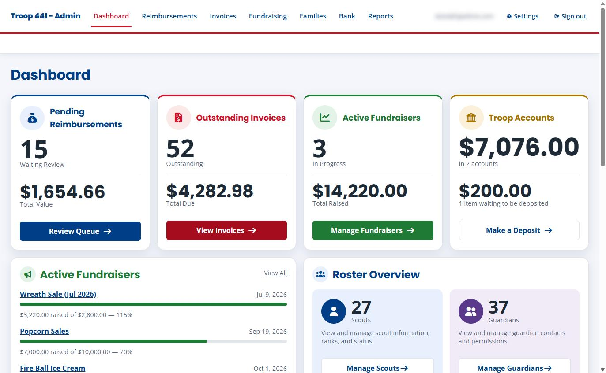

# Troop Finances

[](https://github.com/sacparker09/troop-finances/actions/workflows/ci.yml)
[](LICENSE)

Money tracking for a Scouts BSA troop: reimbursement receipts that adults submit, invoices scouts
owe (trips, camp, meals), and fundraiser proceeds credited to individual scouts' accounts. Parents
see their scout's balance and submit receipts from their phone; the treasurer manages the rest.



More screens, from reimbursements to bank reconciliation: [docs/SCREENSHOTS.md](docs/SCREENSHOTS.md).

## Set it up for your troop

Any Scouts BSA troop can run its own copy, with its own database and nothing shared with
any other troop. Nothing about a particular troop is written into the app.

**Before you deploy**, set up Google sign-in and an email service (about 20 minutes, the same
for every host). [infra/SETUP.md](infra/SETUP.md) walks through it, then each host step by step.

<table>
  <thead>
    <tr>
      <th align="left">Host</th>
      <th align="left">Deploy</th>
      <th align="right">Per month</th>
      <th align="left">Best for</th>
    </tr>
  </thead>
  <tbody>
    <tr>
      <td><b>Render</b></td>
      <td><a href="https://render.com/deploy?repo=https://github.com/sacparker09/troop-finances"></a></td>
      <td align="right">~$13</td>
      <td>The simplest setup: everything in one place. <a href="infra/SETUP.md#render">Guide</a></td>
    </tr>
    <!-- Railway: uncomment once the template is published (infra/BUTTONS.md), with its code in place of TEMPLATE_CODE.
    <tr>
      <td><b>Railway</b></td>
      <td><a href="https://railway.com/deploy/TEMPLATE_CODE?utm_medium=integration&utm_source=button&utm_campaign=troop-finances"></a></td>
      <td align="right">~$5–10</td>
      <td>Like Render, billed by use. <a href="infra/SETUP.md#railway">Guide</a></td>
    </tr>
    -->
    <tr>
      <td><b>DigitalOcean</b></td>
      <td><a href="https://cloud.digitalocean.com/apps/new?repo=https://github.com/sacparker09/troop-finances/tree/main"></a></td>
      <td align="right">~$24</td>
      <td>Troops already using DigitalOcean. <a href="infra/SETUP.md#digitalocean">Guide</a></td>
    </tr>
    <tr>
      <td><b>Azure</b></td>
      <td><a href="https://portal.azure.com/#create/Microsoft.Template/uri/https%3A%2F%2Fraw.githubusercontent.com%2Fsacparker09%2Ftroop-finances%2Fmain%2Finfra%2Fcontainer-apps%2Fazuredeploy.json"></a></td>
      <td align="right">~$17</td>
      <td>Troops with Azure or nonprofit credits. Also <code>azd up</code>. <a href="infra/SETUP.md#azure">Guide</a></td>
    </tr>
    <tr>
      <td><b>Fly.io</b></td>
      <td><a href="infra/SETUP.md#flyio">Command line</a></td>
      <td align="right">~$2–6</td>
      <td>The lowest cost, with a free Neon database.</td>
    </tr>
    <tr>
      <td><b>Your own server</b></td>
      <td><a href="infra/SETUP.md#your-own-server">Docker Compose</a></td>
      <td align="right">~$6–12</td>
      <td>Anyone already running a Linux server.</td>
    </tr>
  </tbody>
</table>

**Just looking?** Try it in your browser with sample data, nothing to install:

<a href="https://codespaces.new/sacparker09/troop-finances?quickstart=1"></a>

Prices are estimates for a troop-sized site; each host bills whoever creates the account.

## Who uses it

- **Treasurers and leaders** (`/admin`) sign in with a Microsoft or Google account. They review
  and pay reimbursements, issue invoices, record fundraiser proceeds, and manage the roster.
  Signing in grants nothing by itself: an Editor gives each person **Read only** or **Edit**
  access under Settings > People & access, and every change is recorded in Activity History.
- **Parents and guardians** (`/portal`) sign in with a code emailed to them, or an
  authenticator app. They submit receipts and see their scout's balance and invoices.

The full rules (the first Editor, global admins, temporary Edit, authenticator apps) are in
[docs/ACCESS.md](docs/ACCESS.md).

On a phone, the site installs as a home-screen app named for the troop (e.g. **52 Finance**),
with the troop's number on its icon. Signed-in users see an "Add to your home screen" prompt, with
Safari's steps on iPhone and iPad.

## How the money is kept

- Each **scout** has a running balance, backed by an append-only **ledger** (`ScoutLedger`).
  Fundraiser allocations credit it; invoices can be paid from it. The ledger is the source of
  truth; the scout's `CachedBalance` is kept in step with it (`Services/ScoutAccountService.cs`).
- Normal actions never push a balance below zero: they use only what's available. A
  **manual adjustment**, with a required reason, is the one way to correct it.
- Payments are **record-keeping only**: no payment processor. Reimbursements and invoices are
  marked paid after the money moves outside the app.
- Every change that moves money is **one database transaction**: the ledger entry, balance,
  invoice, payment and audit entry are saved together or not at all (`Data/FinanceDb.cs`).
  Emails go out only after it commits.
- Records live in SQL Server (Azure SQL) or PostgreSQL, through EF Core. Receipts are in private
  storage (Azure Blob Storage, an S3 bucket, or a folder): every download goes through a
  signed-in, ownership-checked endpoint.
- Every night the app backs up all records and receipts, keeping the newest 14.

## Email

Every email goes through `Services/EmailNotificationService.cs`, which checks the on/off setting
for its type, sends, and logs a summary (never the body) in `EmailLog`:

| Email | To | |
|---|---|---|
| Sign-in code | The guardian signing in | Always on |
| Authenticator app added or removed | The guardian | Always on |
| Receipt submitted | Admin notification addresses and the guardian | |
| Receipt approved, rejected or paid | The guardian | |
| Invoice issued | The scout's linked guardians | |
| Edit access granted | Editors, the committee chair, `Auth:EditorGrantNotify` | Off until turned on |

Settings (`/admin/settings`) turns each one on or off, holds the admin notification addresses,
and shows the last 3 months of sent email. A failed email is logged but never blocks the action
that sent it.

## Local development

The quickest start, with nothing to install but Docker:

```bash
docker compose up --build
```

Open http://localhost:8080 (fake admin sign-in, sample data); sign-in codes arrive in Mailpit at
http://localhost:8025. Add `-f docker-compose.yml -f docker-compose.postgres.yml` for PostgreSQL.

To work on the code with `dotnet run`, you need the .NET 10 SDK, SQL Server LocalDB (installed
with Visual Studio) and [Azurite](https://learn.microsoft.com/azure/storage/common/storage-use-azurite)
for receipt files:

```bash
npm install -g azurite
azurite --silent --location ./azurite-data          # leave running

cd src/BsaTroopFinances
dotnet user-secrets set "Auth:LoginCodePepper" "any-long-random-string-for-local-dev"
dotnet run --launch-profile dev-signin
```

- **Dev sign-in.** The `dev-signin` profile signs you in at `/dev/signin` as a fake Editor
  (`?role=Reader` for read only, `?role=None` for no access) and loads a small sample troop into
  an empty database. It refuses to start outside Development (`Services/DevAuth.cs`). To use real
  Microsoft or Google sign-in instead, set their client id and secret with user-secrets and run
  without the profile.
- **Email.** In Development nothing is sent: each email, sign-in codes included, is written to the
  console.
- **Database.** The app creates and updates its database on startup. After changing an entity,
  add a migration for **each** engine (`dotnet tool restore` once first); a test fails if either
  is missing:
  ```bash
  dotnet ef migrations add <Name> --project src/BsaTroopFinances --context FinanceDbContext --output-dir Data/Migrations
  dotnet ef migrations add <Name> --project src/BsaTroopFinances --context PostgresFinanceDbContext --output-dir Data/PostgresMigrations
  ```
- **Lots of data.** `dotnet run -- seed-test-data` adds a year of activity for paging, filters and
  reports; see [docs/TEST-DATA.md](docs/TEST-DATA.md).

## Tests

```bash
dotnet test
```

- **Page tests** render admin pages in memory with [bUnit](https://bunit.dev), signed in as a
  fake user, with [NSubstitute](https://nsubstitute.github.io) fakes for what each page uses.
- **Database tests** (`Sql*Tests`) run the real repositories, services, migrations and backups
  against a throwaway database per test class, including transactions that must roll back
  completely when something fails partway. They use LocalDB, or the server in
  `TROOPFIN_TEST_POSTGRES` or `TROOPFIN_TEST_SQLSERVER` (a connection string without a database
  name), and skip themselves when none is available.
- **Storage tests** hold every file store to the same behaviour: a folder, S3 (an in-memory
  stand-in), and Azure Blob Storage when Azurite is running.

On GitHub, [ci.yml](.github/workflows/ci.yml) runs every test on each push and pull request,
against both PostgreSQL and SQL Server, with nothing skipped. Each run's **Summary** lists every
test.

When writing tests, note that money inputs fill from the cents like a cash register: typing `50`
means $0.50, so type `50.00`.

## More documentation

- [infra/SETUP.md](infra/SETUP.md): setting it up for a troop, host by host.
- [infra/HOSTING.md](infra/HOSTING.md): every setting, the database and storage choices, and
  letting the app sleep when idle.
- [infra/DEPLOY.md](infra/DEPLOY.md): the Azure App Service deployment (`infra/main.bicep`, and
  `infra/deploy.ps1` for code changes), backups and restoring.
- [infra/BUTTONS.md](infra/BUTTONS.md): maintaining the deploy buttons and the published image.
- [docs/SCREENSHOTS.md](docs/SCREENSHOTS.md): a tour of the admin pages.
- [docs/ACCESS.md](docs/ACCESS.md): who can sign in and what they can do.
- [docs/TEST-DATA.md](docs/TEST-DATA.md): generating test data.

Free to use under the [MIT License](LICENSE).
