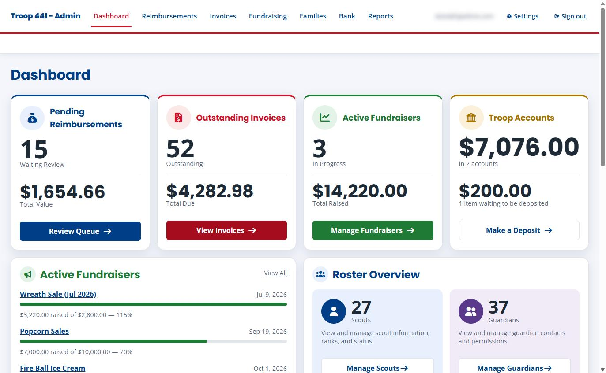
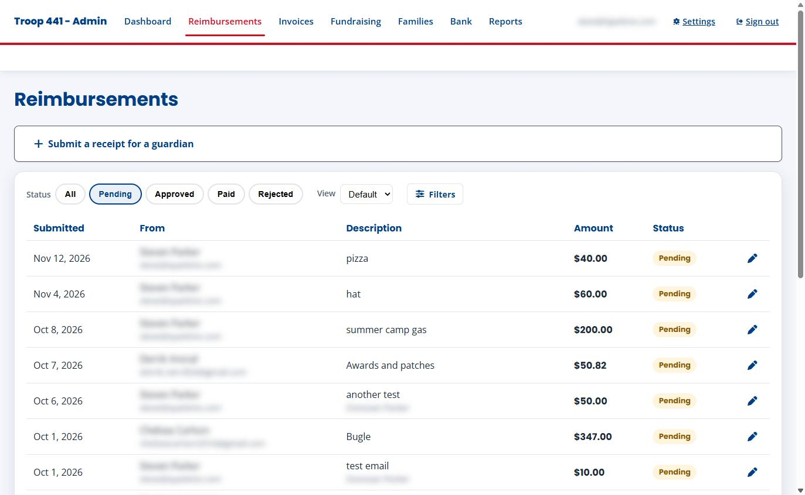
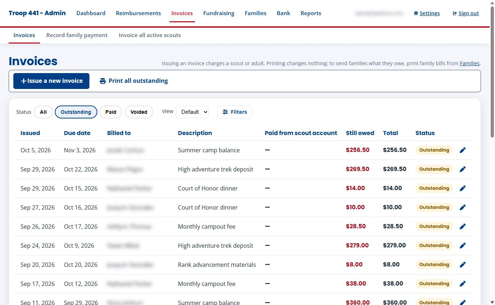
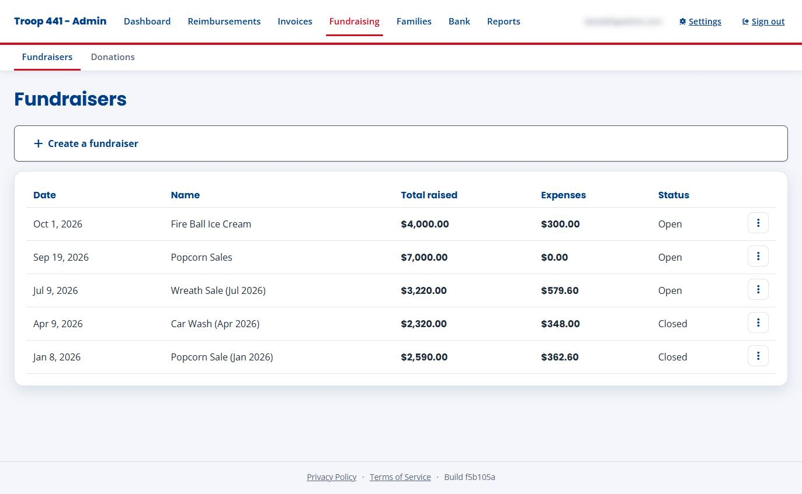
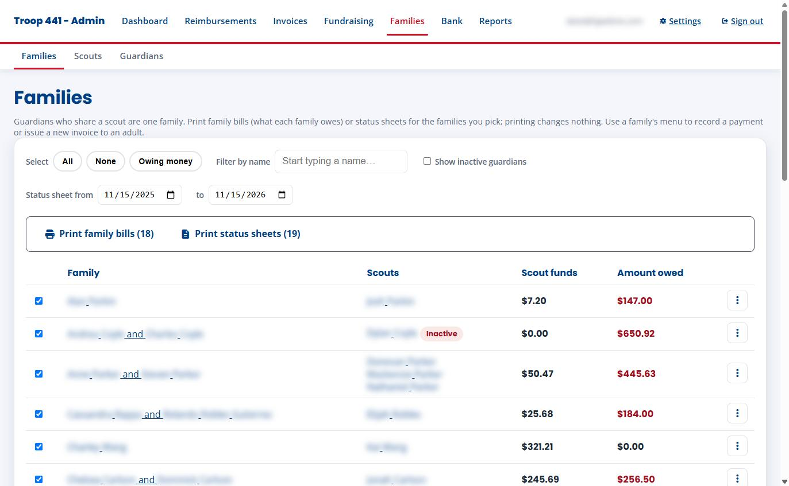
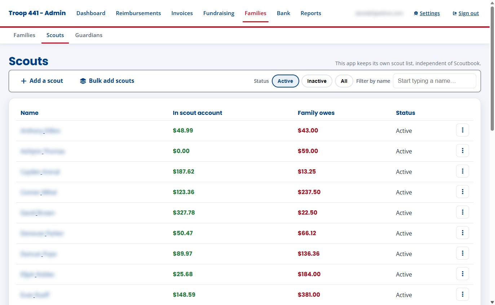
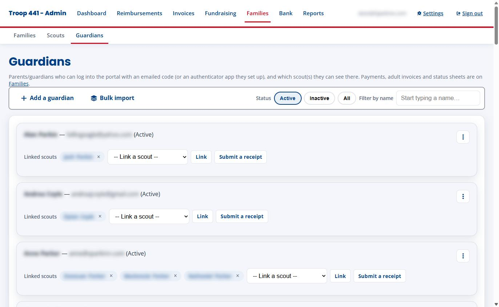
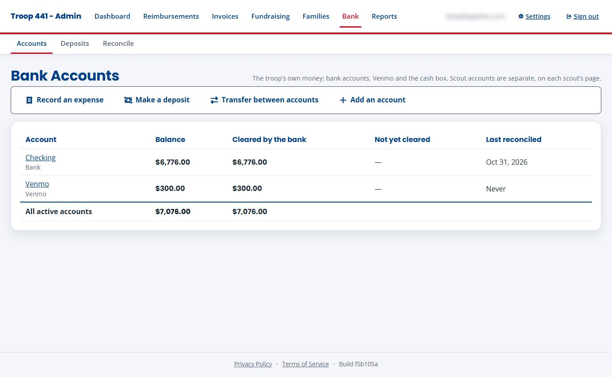
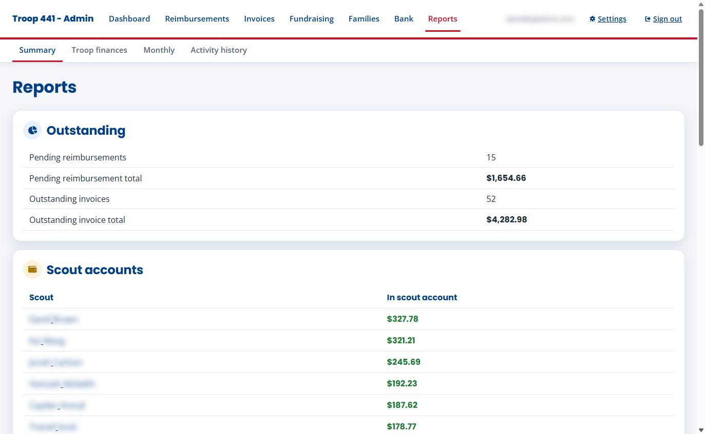
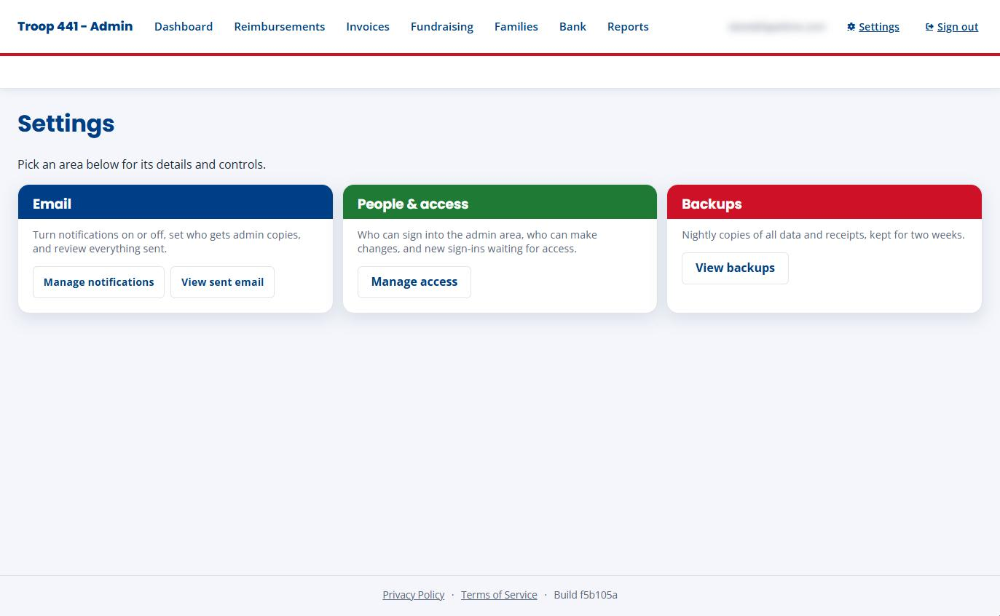

# Screenshots

A tour of the admin area (`/admin`), the treasurer's and leaders' side of the app. Names and
email addresses are blurred.

## Dashboard

What needs attention: receipts waiting for review, invoices still owed, fundraisers in progress,
and the troop's money, including cash and checks not yet deposited.

## Reimbursements

Receipts adults submitted, from the parent portal or entered for them. Review each one, then
approve, reject or mark it paid.

## Invoices

What scouts and adults owe: camp, trips, dinners. An invoice can be paid from the scout's
account, and families can be billed all at once with **Invoice all active scouts**.

## Fundraising

Each fundraiser's proceeds and expenses. Proceeds are credited to individual scouts' accounts.
Donations have their own tab.

## Families

Guardians who share a scout are one family. Print family bills or status sheets for the families
you pick, or record a payment from a family's menu.

### Scouts

Each scout's account balance and what the family owes. The app keeps its own scout list.

### Guardians

Parents and guardians who can sign into the portal, and which scouts each can see.

## Bank

The troop's own money: bank accounts, Venmo and the cash box. Record expenses, deposits and
transfers, and reconcile against the bank statement.

## Reports

Outstanding totals, scout account balances, troop finances by category, monthly figures and the
full activity history.

## Settings

Email notifications and the sent-email log, who can sign in and edit
([ACCESS.md](ACCESS.md)), and the nightly backups.

